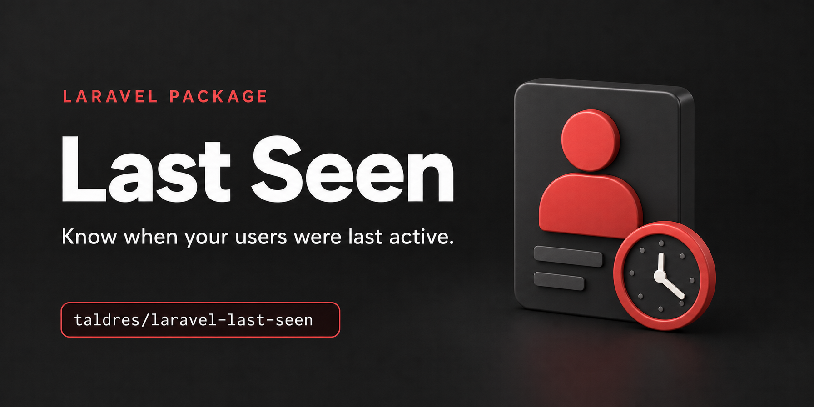

[](https://packagist.org/packages/taldres/laravel-last-seen)


# Laravel Last Seen

A simple Laravel package to track a user's last seen and recently seen status. This package provides traits, middleware, events, and configuration to easily record and query when a user was last active in your Laravel application.

```php
User::onlyRecentlySeen()->count();                // how many users were seen in the last few minutes
User::lastSeenBefore(now()->subDays(30))->get();  // who was last seen more than a month ago
$user->last_seen_at?->diffForHumans() ?? 'never'; // when a user was last seen
```

## Features

- Automatically update the `last_seen_at` timestamp for users
- Middleware to detect user activity
- Event-based architecture for extensibility
- Query scopes and helper methods to find users who were recently seen, never seen or last seen before a date
- Configurable thresholds for updating and checking activity
- Leave out background requests and let users opt out
- A command to forget old values, to keep the data only as long as needed
- A fake with assertions for your own tests
- Migration publishing for easy setup

## What It Measures

The package records the time of a user's last request. From that it tells you when a user was **last seen** and
whether they were **recently seen**, meaning within `LAST_SEEN_RECENTLY_SEEN_THRESHOLD` seconds.

It does not tell you whether a user is present right now. A user who closed the browser tab still counts as recently
seen until the threshold has passed, and a user who reads a page for ten minutes without sending a request does not.
For live presence, such as a list of who is viewing a page, use
[presence channels](https://laravel.com/docs/broadcasting#presence-channels).

## Why Use This Package?

Updating a timestamp is easy. Handling concurrent requests, limiting writes, and keeping Eloquent timestamps and model
events untouched takes more care. This package handles those details and adds request filtering, per-user opt-outs,
query scopes, and a fake for your tests.

- **Throttled, conditional writes.** `last_seen_at` is written at most once per `LAST_SEEN_UPDATE_THRESHOLD` seconds
  with a single conditional `UPDATE`, so parallel requests of one user write once.
- **Nothing else changes.** `updated_at`, model events and unsaved attributes stay untouched.
- **You decide what counts.** Leave out background requests with `LastSeen::ignoreRequestsUsing()` and let users opt
  out with `LastSeen::trackUsing()`.
- **Ready for queries and tests.** Scopes such as `onlyRecentlySeen()` and `lastSeenBefore()`, and `LastSeen::fake()`
  for your own tests.

## Requirements

| Laravel Version | Package Version | PHP Version |
|:----------------|:----------------|:------------|
| `^12.0`         | `^1.0`          | `^8.3`      |
| `^13.0`         | `^1.0`          | `^8.3`      |

The test suite runs against SQLite, MySQL, MariaDB, PostgreSQL and SQL Server. See
[Installation](docs/installation.md#supported-databases) for the versions and database-specific notes.

## Installation

1. Install the package via Composer:

    ```bash
    composer require taldres/laravel-last-seen
    ```

2. Publish the migration:

    ```bash
    php artisan vendor:publish --provider="Taldres\LastSeen\LastSeenServiceProvider" --tag=last-seen-migrations
    ```

   The migration finds your users table through the `models.user` setting. You only need to publish the configuration
   file to change it or other settings, see [Configuration](docs/configuration.md).

3. Run the migration to add the `last_seen_at` column to your users table:

    ```bash
    php artisan migrate
    ```

   If your users table already has a `last_seen_at` column, the migration stops with an error instead of taking over a
   column it would drop on rollback. Delete the published migration in that case.

4. Add the `Taldres\LastSeen\Trait\LastSeen` trait to your User model:

    ```php
    use Taldres\LastSeen\Trait\LastSeen;
    
    class User extends Authenticatable
    {
        use LastSeen;
        // ...
    }
    ```
   
5. Add the middleware to your `web` or `api` middleware group in `bootstrap/app.php`, or to individual routes:

    ```php
    // bootstrap/app.php
    ->withMiddleware(function (Middleware $middleware): void {
        $middleware->web(append: [
            \Taldres\LastSeen\Middleware\UpdateLastSeenMiddleware::class,
        ]);

        // Token-based APIs, e.g. with Laravel Sanctum:
        $middleware->api(append: [
            \Taldres\LastSeen\Middleware\UpdateLastSeenMiddleware::class,
        ]);
    })
    ```

   The middleware resolves the authenticated user after the request has been handled, so it also works when
   authentication happens later in the stack, e.g. through a route-level `auth:sanctum` middleware.

6. Check the setup:

    ```bash
    php artisan about --only=last_seen
    ```

   The "Last Seen" section shows whether the package is enabled, the user model and whether it uses the trait, and both
   thresholds. It marks a missing trait, an invalid threshold and a recently seen threshold that is not above the update
   threshold.

## Configuration

All settings have defaults and can be changed in your `.env` file:

- `LAST_SEEN_ENABLED`: Enables or disables the package globally (default: true). While it is off, `updateLastSeenAt()`, `LastSeen::record()` and the middleware write nothing. `forgetLastSeenAt()`, the scopes and `recentlySeen()` keep working.
- `LAST_SEEN_UPDATE_THRESHOLD`: Minimum seconds between last_seen_at updates (default: 60)
- `LAST_SEEN_RECENTLY_SEEN_THRESHOLD`: Seconds a user is considered recently seen after last activity (default: 300)

To change the user model or publish the configuration file, see [Configuration](docs/configuration.md).

## Quick Start

Once the middleware runs, every request of an authenticated user counts as activity, and `last_seen_at` is written at
most once per `LAST_SEEN_UPDATE_THRESHOLD` seconds. See [How Activity Is Tracked](docs/basic-usage/tracking-activity.md).

Check and query activity, see [Checking Activity](docs/basic-usage/checking-activity.md):

```php
$user->recentlySeen();                             // seen within LAST_SEEN_RECENTLY_SEEN_THRESHOLD seconds
User::onlyRecentlySeen()->get();                   // users who were recently seen
User::notRecentlySeen()->get();                    // everyone else, including users who were never seen
User::neverSeen()->get();                          // users whose last_seen_at is null
User::lastSeenBefore(now()->subDays(30))->get();   // users last seen before a date
User::lastSeenSince(now()->subMinutes(15))->get(); // users last seen at or after a date
```

```blade
@if ($user->recentlySeen())
    Recently active
@else
    Last seen {{ $user->last_seen_at?->diffForHumans() ?? 'never' }}
@endif
```

React when `last_seen_at` was written, see [Events](docs/advanced-usage/events.md):

```php
use Taldres\LastSeen\Events\LastSeenRecordedEvent;

Event::listen(function (LastSeenRecordedEvent $event) {
    if ($event->becameRecentlySeen) {
        // $event->user was not recently seen before this write.
    }
});
```

Leave out background requests and let users opt out, in a service provider's `boot()` method, see
[Choosing Which Requests Count](docs/advanced-usage/choosing-which-requests-count.md) and
[Opting Users Out](docs/privacy.md#opting-users-out):

```php
use Illuminate\Http\Request;
use Taldres\LastSeen\Facades\LastSeen;

LastSeen::ignoreRequestsUsing(fn (Request $request): bool => $request->is('api/notifications/poll'));
LastSeen::trackUsing(fn (User $user): bool => ! $user->hide_activity_status);
```

Assert in your tests which users were recorded, see [Testing Your Application](docs/advanced-usage/testing.md):

```php
LastSeen::fake();

$this->actingAs($user)->get('/dashboard');

LastSeen::assertRecorded($user);
```

## Documentation

The full documentation is in [`docs/`](docs/README.md): how activity is tracked, the query scopes, the events, leaving
out background requests, several user models, testing your application, recipes such as reminding inactive users, and
privacy.

## AI Agents

The package ships two [Laravel Boost](https://laravel.com/framework/docs/boost) skills for coding agents:

- `laravel-last-seen-development` teaches agents how to use the package.
- `upgrade-laravel-last-seen-v1` walks agents through the upgrade from 0.4 to 1.0.

Boost offers to install them when you run `php artisan boost:install`, or `php artisan boost:update --discover` in an
existing setup.

## Privacy

`last_seen_at` is tied to a user, so it is personal data. The package stores a single `last_seen_at` column, keeps no
activity history and sends no data to external services. See [Privacy](docs/privacy.md) for what your application
decides, opting users out, deleting the timestamp and forgetting old values.

## Upgrading

See [UPGRADE.md](UPGRADE.md) for the changes between major versions, including the upgrade from 0.4 to 1.0. It also
explains how to let a coding agent do the upgrade with the `upgrade-laravel-last-seen-v1` skill.

## Contributing

See [CONTRIBUTING](.github/CONTRIBUTING.md). Please report security vulnerabilities as described in
[SECURITY](.github/SECURITY.md) instead of opening a public issue.

## License

MIT
